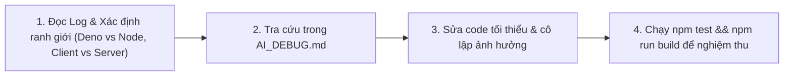

# 🩺 AI DEBUG RUNBOOK & SYSTEM ERROR KNOWLEDGE BASE
## Cẩm Nang Tra Cứu, Gỡ Lỗi & Phòng Ngừa Sự Cố (BER Project)

> **MỤC ĐÍCH TÀI LIỆU**:
> File này đóng vai trò là **"Sổ tay chẩn đoán & chữa bệnh"** cho toàn bộ dự án **Nhắc Sinh Nhật & Sự Kiện (BER)**.
> Khi lập trình viên hoặc AI Assistant gặp bất kỳ lỗi nào trong quá trình phát triển, kiểm thử hoặc build/deploy, hãy tra cứu ngay mã lỗi và triệu chứng tại đây để khắc phục tức thì với giải pháp đã được chứng minh hiệu quả.

---

## 📑 MỤC LỤC
1. [Quy Trình Gỡ Lỗi Chuẩn 4 Bước (Standard Debugging Protocol)](#1-quy-trình-gỡ-lỗi-chuẩn-4-bước)
2. [Bảng Tra Cứu Nhanh Lỗi (Quick Diagnosis Index)](#2-bảng-tra-cứu-nhanh-lỗi)
3. [Hồ Sơ Chi Tiết Các Lỗi Thực Tế Đã Xử Lý (Case Studies)](#3-hồ-sơ-chi-tiết-các-lỗi-thực-tế-đã-xử-lý)
   - [Case 01: Next.js tsconfig quét nhầm Deno Edge Functions](#case-01-nextjs-tsconfig-quét-nhầm-deno-edge-functions)
   - [Case 02: Lỗi Import Relative giữa App Next.js và Deno Functions](#case-02-lỗi-import-relative-giữa-app-nextjs-và-deno-functions)
   - [Case 03: Supabase JS Client v2 TypeScript Fallback về `never`](#case-03-supabase-js-client-v2-typescript-fallback-về-never)
   - [Case 04: Mismatch Signature Callback giữa TanStack Query và Component Props](#case-04-mismatch-signature-callback-giữa-tanstack-query-và-component-props)
   - [Case 05: `useSearchParams()` thiếu `<Suspense>` trong App Router](#case-05-usesearchparams-thiếu-suspense-trong-app-router)
   - [Case 06: Thuật toán Âm lịch Hồ Ngọc Đức lệch năm âm lịch](#case-06-thuật-toán-âm-lịch-hồ-ngọc-đức-lệch-năm-âm-lịch)
4. [Các Lỗi Tiềm Ẩn Thường Gặp & Cách Phòng Ngừa (Potential Pitfalls)](#4-các-lỗi-tiềm-ẩn-thường-gặp--cách-phòng-ngừa)
   - [Pitfall 01: Hydration Mismatch do lệch giờ Server và Client](#pitfall-01-hydration-mismatch-do-lệch-giờ-server-và-client)
   - [Pitfall 02: Cookie Session Sync trong Next.js App Router](#pitfall-02-cookie-session-sync-trong-nextjs-app-router)
   - [Pitfall 03: Vòng lặp đệ quy vô tận trong Supabase RLS Policy](#pitfall-03-vòng-lặp-đệ-quy-vô-tận-trong-supabase-rls-policy)
   - [Pitfall 04: Lỗi CORS khi gọi Supabase Edge Functions](#pitfall-04-lỗi-cors-khi-gọi-supabase-edge-functions)
5. [Bộ Lệnh Kiểm Tra Sức Khỏe Dự Án (Health Check Commands)](#5-bộ-lệnh-kiểm-tra-sức-khỏe-dự-án)

---

## 1. Quy Trình Gỡ Lỗi Chuẩn 4 Bước

Khi gặp lỗi trong dự án này, AI hoặc Developer cần tuân thủ 4 bước:



1. **Bước 1 (Xác định ranh giới lỗi)**: 
   - Lỗi ở phía Client (React/Browser), Server (Next.js Node.js), Database (Postgres/RLS) hay Edge Function (Deno)?
2. **Bước 2 (Tra cứu Runbook)**: 
   - Đối chiếu với [Mục 2](#2-bảng-tra-cứu-nhanh-lỗi) bên dưới.
3. **Bước 3 (Sửa code chuẩn xác)**: 
   - Áp dụng đoạn code diff mẫu, không sửa tràn lan làm ảnh hưởng các module khác.
4. **Bước 4 (Nghiệm thu bắt buộc)**:
   - Chạy `npm test` và `npm run build`. Phải đạt `Exit Code: 0` mới coi là hoàn thành.

---

## 2. Bảng Tra Cứu Nhanh Lỗi

| Phân Loại | Triệu Chứng Lỗi (Error Message) | File Bị Ảnh Hưởng | Giải Pháp Nhanh |
| :--- | :--- | :--- | :--- |
| **Deno / TS** | `Cannot find module 'https://esm.sh/...'` | `supabase/functions/send-reminders/index.ts` | Thêm `"supabase"` vào `"exclude"` trong `tsconfig.json` |
| **Webpack** | `Module not found: Can't resolve '../../.../supabase/...'` | `src/app/api/test-email/route.ts` | Tách shared logic ra `src/lib/email/template-builder.ts` |
| **Supabase** | `Argument of type 'any' is not assignable to parameter of type 'never'` | `src/hooks/use-events.ts`, `use-user-settings.ts` | Dùng `(supabase as any).from("events").update(...)` |
| **TanStack** | `Type 'UseMutateAsyncFunction' is not assignable to '(id, enabled) => void'` | `src/hooks/use-events.ts` | Bọc arrow function `(id, enabled) => mutateAsync({ id, enabled })` |
| **App Router**| `useSearchParams() should be wrapped in a suspense boundary` | `src/app/(dashboard)/events/page.tsx` | Tách `EventsContent` và bọc trong `<Suspense fallback={...}>` |
| **Âm Lịch** | `AssertionError: expected 2023 to be 2024` khi test Tết 2024 | `src/lib/lunar/amlich.ts` | Đổi `lunarYear = yy` khi `a11 >= monthStart` (không trừ 1) |
| **Postgres/RLS** | `ERROR: 42710: policy "..." already exists` | `supabase/migrations/` | Thêm `DROP POLICY IF EXISTS "..." ON ...;` trước `CREATE POLICY` |
| **Next.js Dev** | `500 Internal Server Error _next/static/...` (Mất CSS) | Thư mục `.next/` | Xóa `.next/` và khởi động lại `npm run dev` |
| **Hydration** | `Text content did not match. Server: ... Client: ...` | Các component format ngày | Bọc format date trong hook hoặc dùng `suppressHydrationWarning` |
| **RLS Policy**| `new row violates row-level security policy for table "events"` | `supabase/migrations/` | Kiểm tra payload có `user_id = auth.uid()` hoặc user đã login chưa |

---

## 3. Hồ Sơ Chi Tiết Các Lỗi Thực Tế Đã Xử Lý

### Case 01: Next.js tsconfig quét nhầm Deno Edge Functions

- **Mã lỗi chi tiết**:
  ```
  ./supabase/functions/send-reminders/index.ts:5:30
  Type error: Cannot find module 'https://esm.sh/@supabase/supabase-js@2.46.1' or its corresponding type declarations.
  ```
- **Vị trí**: [supabase/functions/send-reminders/index.ts](file:///e:/BER-Birthday-Event-Reminder-/supabase/functions/send-reminders/index.ts)
- **Nguyên nhân kỹ thuật**:
  - Supabase Edge Functions chạy trên môi trường **Deno runtime**, trong đó module được import qua URL (`https://esm.sh/...`).
  - Next.js chạy trên **Node.js runtime** và `tsconfig.json` mặc định cấu hình `"include": ["**/*.ts"]`, khiến TypeScript của Next.js quét toàn bộ thư mục `supabase/` và báo lỗi không hiểu cú pháp import URL.
- **Cách khắc phục**:
  Thêm thư mục `"supabase"` vào mục `"exclude"` trong [tsconfig.json](file:///e:/BER-Birthday-Event-Reminder-/tsconfig.json):
  ```diff
    "include": ["next-env.d.ts", "**/*.ts", "**/*.tsx", ".next/types/**/*.ts"],
  - "exclude": ["node_modules"]
  + "exclude": ["node_modules", "supabase"]
  ```
- **Quy tắc phòng ngừa**: Không bao giờ để TypeScript của Node.js typecheck thư mục chứa mã Deno.

---

### Case 02: Lỗi Import Relative giữa App Next.js và Deno Functions

- **Mã lỗi chi tiết**:
  ```
  ./src/app/api/test-email/route.ts
  Module not found: Can't resolve '../../../../../supabase/functions/send-reminders/email-template'
  ```
- **Vị trí**: `src/app/api/test-email/route.ts`
- **Nguyên nhân kỹ thuật**:
  - Không được import file trực tiếp từ `supabase/functions/` vào trong `src/` bằng đường dẫn relative sâu (`../../../../`). Webpack khi đóng gói bundle cho Next.js không quản lý được ranh giới ngoài root và có thể gây lỗi resolution trên các hệ điều hành khác nhau (Windows vs Linux trên Vercel).
- **Cách khắc phục**:
  Tạo file tiện ích dùng chung chuẩn trong thư mục `src/lib/email/template-builder.ts` và import bằng path alias:
  ```diff
  - import { generateReminderEmailHtml } from "../../../../../supabase/functions/send-reminders/email-template";
  + import { generateReminderEmailHtml } from "@/lib/email/template-builder";
  ```
- **Quy tắc phòng ngừa**: Mọi mã nguồn mà Next.js sử dụng phải luôn nằm bên trong thư mục `src/` và import qua alias `@/...`.

---

### Case 03: Supabase JS Client v2 TypeScript Fallback về `never`

- **Mã lỗi chi tiết**:
  ```
  Type error: Argument of type '{ name: string; ... }' is not assignable to parameter of type 'never'.
  trên lệnh supabase.from("events").update(...) hoặc supabase.from("user_settings").update(...)
  ```
- **Vị trí**: [src/hooks/use-events.ts](file:///e:/BER-Birthday-Event-Reminder-/src/hooks/use-events.ts), [src/hooks/use-user-settings.ts](file:///e:/BER-Birthday-Event-Reminder-/src/hooks/use-user-settings.ts)
- **Nguyên nhân kỹ thuật**:
  - `@supabase/supabase-js` v2 sử dụng generic type inference rất phức tạp từ `Database`. Khi một payload update hoặc insert có chứa các thuộc tính optional, union types (`"birthday" | "anniversary" | ...`) hoặc `null | undefined`, TypeScript builder overload không khớp chính xác overload nào và tự động fallback về overload nhận kiểu `never`.
- **Cách khắc phục**:
  1. Ép kiểu client gọi bảng: `(supabase as any).from("events").update(...)`.
  2. Với lệnh `.insert()`, tách trường `id` ra khỏi payload để Postgres tự sinh `gen_random_uuid()`:
  ```typescript
  // Update an toàn
  const { data, error } = await (supabase as any)
    .from("events")
    .update({ ...payload } as any)
    .eq("id", id);

  // Insert an toàn
  const { id: _ignore, ...eventPayload } = newEvent;
  const { data, error } = await (supabase as any)
    .from("events")
    .insert({ ...eventPayload, user_id: session.user.id } as any);
  ```
- **Quy tắc phòng ngừa**: Luôn sử dụng `(supabase as any).from("<table_name>")` cho các mutation update/insert/delete trong TanStack Query.

---

### Case 04: Mismatch Signature Callback giữa TanStack Query và Component Props

- **Mã lỗi chi tiết**:
  ```
  Type error: Type 'UseMutateAsyncFunction<void, Error, { id: string; enabled: boolean; }>' 
  is not assignable to type '(id: string, enabled: boolean) => void'.
  ```
- **Vị trí**: [src/hooks/use-events.ts](file:///e:/BER-Birthday-Event-Reminder-/src/hooks/use-events.ts)
- **Nguyên nhân kỹ thuật**:
  - Hàm `mutateAsync` của TanStack Query chỉ chấp nhận 1 đối số duy nhất (object biến `{ id, enabled }`).
  - Trong khi đó, component con (như `EventCard`) truyền theo dạng 2 tham số riêng biệt: `onToggleEnabled(id, enabled)`.
- **Cách khắc phục**:
  Bọc thành arrow function tương thích trước khi export từ custom hook:
  ```diff
    return {
  -   deleteEvent: deleteMutation.mutateAsync,
  -   toggleEventEnabled: toggleEnabledMutation.mutateAsync,
  +   deleteEvent: (id: string) => deleteMutation.mutateAsync(id),
  +   toggleEventEnabled: (id: string, enabled: boolean) =>
  +     toggleEnabledMutation.mutateAsync({ id, enabled }),
    };
  ```
- **Quy tắc phòng ngừa**: Khi export mutation từ hook tùy chỉnh, luôn bọc thành arrow function để khớp với props của component giao diện.

---

### Case 05: `useSearchParams()` thiếu `<Suspense>` trong App Router

- **Mã lỗi chi tiết**:
  ```
  useSearchParams() should be wrapped in a suspense boundary at page "/events"
  ```
- **Vị trí**: [src/app/(dashboard)/events/page.tsx](file:///e:/BER-Birthday-Event-Reminder-/src/app/%28dashboard%29/events/page.tsx)
- **Nguyên nhân kỹ thuật**:
  - Trong Next.js 14 App Router, nếu một Client Component đọc query string từ URL thông qua `useSearchParams()`, Next.js không thể pre-render trang thành static HTML lúc build trừ khi component đó được bao bọc trong một `<Suspense>` boundary.
- **Cách khắc phục**:
  Tách logic trang thành một component con `EventsContent` và bọc trang chính trong `<Suspense>`:
  ```tsx
  function EventsContent() {
    const searchParams = useSearchParams();
    // Logic của trang
  }

  export default function EventsPage() {
    return (
      <Suspense fallback={<div className="animate-pulse h-32 rounded-3xl bg-card" />}>
        <EventsContent />
      </Suspense>
    );
  }
  ```
- **Quy tắc phòng ngừa**: Bất kỳ trang nào sử dụng `useSearchParams()` đều phải có `<Suspense>`.

---

### Case 06: Thuật toán Âm lịch Hồ Ngọc Đức lệch năm âm lịch

- **Mã lỗi chi tiết**:
  ```
  AssertionError: expected 2023 to be 2024 // Object.is equality
  Khi chạy test: convertSolar2Lunar(10, 2, 2024) (Mùng 1 Tết Giáp Thìn 2024)
  ```
- **Vị trí**: [src/lib/lunar/amlich.ts](file:///e:/BER-Birthday-Event-Reminder-/src/lib/lunar/amlich.ts) dòng 140 - 150
- **Nguyên nhân kỹ thuật**:
  - Nhầm lẫn trong việc trừ năm ở nhánh `a11 >= monthStart`. Theo nguyên lý thiên văn của GS. Hồ Ngọc Đức, `monthStart` là ngày bắt đầu của tháng khảo sát. Nếu `a11 >= monthStart`, ngày đó thuộc về chu kỳ năm âm lịch `yy`, không phải `yy - 1`.
- **Cách khắc phục**:
  ```diff
    let lunarYear = yy;
    if (a11 >= monthStart) {
  -   lunarYear = yy - 1;
  +   lunarYear = yy;
      a11 = getLunarMonth11(yy - 1, TIMEZONE);
    } else {
      lunarYear = yy + 1;
      b11 = getLunarMonth11(yy + 1, TIMEZONE);
    }
  ```
- **Quy tắc phòng ngừa**: Giữ nguyên vẹn thuật toán thiên văn chuẩn và luôn chạy `npm test` để xác minh.

---

### Case 07: Lỗi `ERROR: 42710: policy ... already exists` khi chạy SQL Migration

- **Mã lỗi chi tiết**:
  ```
  Failed to run sql query: ERROR: 42710: policy "Users can view their own profile" for table "profiles" already exists
  ```
- **Vị trí**: [supabase/migrations/20261023_001_initial_schema.sql](file:///e:/BER-Birthday-Event-Reminder-/supabase/migrations/20261023_001_initial_schema.sql)
- **Nguyên nhân kỹ thuật**:
  - Trong PostgreSQL, lệnh `CREATE POLICY` không hỗ trợ mệnh đề `OR REPLACE` hoặc `IF NOT EXISTS` như một số cú pháp DDL khác. Nếu một migration bị chạy lại hoặc chạy tiếp nối sau khi đã tạo một số policy trước đó, PostgreSQL sẽ dừng thực thi và ném lỗi `42710`.
- **Cách khắc phục**:
  - Luôn đặt `DROP POLICY IF EXISTS "<policy_name>" ON <table_name>;` ngay phía trước mỗi lệnh `CREATE POLICY`:
  ```sql
  DROP POLICY IF EXISTS "Users can view their own profile" ON public.profiles;
  CREATE POLICY "Users can view their own profile"
      ON public.profiles FOR SELECT
      USING (auth.uid() = id);
  ```
- **Quy tắc phòng ngừa**: Viết script migration có tính lũy đẳng (Idempotent) cao, luôn có `DROP ... IF EXISTS` cho triggers, functions và policies.

---

### Case 08: Lỗi `500 Internal Server Error _next/static/...` (Mất sạch CSS & Giao diện vỡ)

- **Mã lỗi chi tiết**:
  ```
  Failed to load resource: the server responded with a status of 500 (Internal Server Error)
  _next/static/css/app/layout.css
  _next/static/chunks/app-internals.js
  Error: Cannot find module './276.js' Require stack: .next\server\webpack-runtime.js
  ```
- **Vị trí**: Toàn bộ trang web khi chạy `npm run dev`.
- **Nguyên nhân kỹ thuật**:
  - Khi đang chạy `next dev` (dev server), nếu lập trình viên hoặc AI thực hiện lệnh `next build` (production build), Next.js sẽ biên dịch và ghi đè toàn bộ thư mục `.next/` theo cấu trúc module production.
  - Lúc này, tiến trình `next dev` vẫn đang giữ bộ nhớ webpack cache ở chế độ development, dẫn đến xung đột hash và thiếu file chunk, trả về HTTP 500 cho tất cả file tĩnh và CSS.
- **Cách khắc phục**:
  1. Dừng tiến trình dev server hiện tại.
  2. Xóa sạch thư mục cache `.next/`:
     ```powershell
     Remove-Item -Recurse -Force .next
     ```
  3. Khởi động lại `npm run dev`.
- **Quy tắc phòng ngừa**: Không bao giờ chạy `next build` khi `next dev` đang chạy nền, hoặc luôn xóa `.next` sau khi chạy `next build` để trả lại môi trường dev sạch sẽ.

---

### Case 09: Lỗi 500 "Database error finding user" khi đăng ký (Sign Up) Supabase Auth

- **Mã lỗi chi tiết**:
  ```
  POST https://<project-ref>.supabase.co/auth/v1/signup 500 (Internal Server Error)
  Response: {"code": 500, "msg": "Database error finding user"}
  ```
- **Vị trí**: Form Đăng ký hoặc Đăng nhập trên frontend gọi `supabase.auth.signUp()`.
- **Nguyên nhân kỹ thuật**:
  1. Khi chèn trực tiếp tài khoản vào `auth.users` bằng câu lệnh SQL thủ công (`INSERT INTO auth.users`), các cột chuỗi như `confirmation_token`, `recovery_token`, `email_change_token_new` bị để mặc định là `NULL`. Trong mã nguồn dịch vụ xác thực GoTrue (viết bằng Go) của Supabase, hàm quét dữ liệu `sql.Scan()` cố gắng nạp giá trị `NULL` vào biến kiểu `string` (thay vì pointer hoặc NullString), ném ra ngoại lệ và trả về HTTP 500 `"Database error finding user"`.
  2. Ngoài ra, nếu trigger `handle_new_user()` trên bảng `auth.users` xảy ra bất kỳ lỗi runtime nào (ví dụ thiếu cột, vi phạm constraint), transaction của GoTrue sẽ bị rollback và gây crash quá trình đăng ký.
- **Cách khắc phục**:
  1. Chạy câu lệnh SQL cập nhật các trường token trong `auth.users` từ `NULL` về chuỗi rỗng `''`:
     ```sql
     UPDATE auth.users 
     SET confirmation_token = COALESCE(confirmation_token, ''),
         recovery_token = COALESCE(recovery_token, ''),
         email_change_token_new = COALESCE(email_change_token_new, ''),
         email_change = COALESCE(email_change, ''),
         phone_change = COALESCE(phone_change, ''),
         phone_change_token = COALESCE(phone_change_token, ''),
         email_change_token_current = COALESCE(email_change_token_current, ''),
         reauthentication_token = COALESCE(reauthentication_token, '');
     ```
  2. Bọc thân trigger `handle_new_user()` trong khối `BEGIN ... EXCEPTION WHEN OTHERS THEN RETURN new; END;` để không bao giờ làm gián đoạn transaction của GoTrue.
  3. Trên frontend, tài khoản admin (`admin`) là tài khoản hệ thống đã có sẵn, nên khi người dùng nhập `admin` tại trang `/register`, hệ thống sẽ tự động nhắc người dùng chuyển sang trang `/login` để đăng nhập.
- **Quy tắc phòng ngừa**: Không bao giờ để `confirmation_token` hoặc `recovery_token` là `NULL` khi insert dữ liệu vào `auth.users`.

---

### Case 10: Lỗi 42703 `column "username" of relation "profiles" does not exist`

- **Mã lỗi chi tiết**:
  ```
  Failed to run sql query: ERROR: 42703: column "username" of relation "profiles" does not exist
  QUERY: INSERT INTO public.profiles (id, display_name, role, username, timezone, onboarded)
  ```
- **Vị trí**: Supabase SQL Editor khi chạy script khởi tạo admin.
- **Nguyên nhân kỹ thuật**:
  - Bảng `public.profiles` ban đầu chỉ có các cột `(id, display_name, avatar_url, timezone, onboarded, created_at)`.
  - Khi người dùng copy script SQL chạy khối lệnh `DO $$ ... INSERT INTO public.profiles (..., username, ...)`, nếu câu lệnh `ALTER TABLE public.profiles ADD COLUMN IF NOT EXISTS username TEXT;` bị thiếu hoặc chưa chạy trước đó, PostgreSQL sẽ ném lỗi cú pháp schema `42703`.
- **Cách khắc phục**:
  - Luôn đảm bảo câu lệnh DDL `ALTER TABLE public.profiles ADD COLUMN IF NOT EXISTS username TEXT;` và `ADD COLUMN IF NOT EXISTS role TEXT;` được thực thi hoàn tất trước các câu lệnh DML `INSERT/UPDATE`.
- **Quy tắc phòng ngừa**: Trong các script migration hoặc seeding data, luôn nhóm các lệnh DDL thêm cột lên trên cùng và chạy trước các khối PL/pgSQL thao tác dữ liệu.

---

### Case 11: Lỗi `function gen_salt(unknown) does not exist`

- **Mã lỗi chi tiết**:
  ```
  ERROR: function gen_salt(unknown) does not exist
  HINT: No function matches the given name and argument types. You might need to add explicit type casts.
  ```
- **Vị trí**: Supabase SQL function hoặc script chạy mã hóa mật khẩu bcrypt `crypt(p_password, gen_salt('bf'))`.
- **Nguyên nhân kỹ thuật**:
  - Trong Supabase Cloud, extension `pgcrypto` được cài đặt mặc định vào schema `extensions`.
  - Khi một function PL/pgSQL được định nghĩa với `SECURITY DEFINER SET search_path = public;`, PostgreSQL chỉ tìm kiếm hàm trong schema `public` mà bỏ qua schema `extensions`, dẫn đến lỗi không tìm thấy `gen_salt` hoặc `crypt`.
- **Cách khắc phục**:
  1. Thêm schema `extensions` vào đường dẫn tìm kiếm: `SET search_path = public, extensions;`.
  2. Đồng thời gọi trực tiếp tiền tố schema: `extensions.crypt(p_password, extensions.gen_salt('bf'))`.
- **Quy tắc phòng ngừa**: Trong môi trường Supabase, mọi hàm mã hóa mật khẩu đều nên gọi trực tiếp qua namespace `extensions.crypt` và `extensions.gen_salt`.

---


## 4. Các Lỗi Tiềm Ẩn Thường Gặp & Cách Phòng Ngừa

### Pitfall 01: Hydration Mismatch do lệch giờ Server và Client
- **Triệu chứng**: `Warning: Text content did not match. Server: "Còn 3 ngày" Client: "Còn 2 ngày"`.
- **Nguyên nhân**: Server render ở múi giờ UTC, còn Client render ở múi giờ máy tính người dùng (`GMT+7`), hoặc qua thời điểm 00:00 đêm.
- **Giải pháp**:
  1. Chỉ tính toán số ngày còn lại bên trong Client Component hoặc hook `useMemo`.
  2. Với các thẻ hiển thị ngày giờ trực tiếp, thêm thuộc tính `suppressHydrationWarning`.

### Pitfall 02: Cookie Session Sync trong Next.js App Router
- **Triệu chứng**: Đã đăng nhập nhưng chuyển trang vẫn bị đá về `/login`.
- **Nguyên nhân**: Cookie Supabase auth token chưa được refresh đồng bộ qua Server Component.
- **Giải pháp**:
  - Sử dụng middleware đồng bộ session cookie như đã thiết lập tại [src/middleware.ts](file:///e:/BER-Birthday-Event-Reminder-/src/middleware.ts).

### Pitfall 03: Vòng lặp đệ quy vô tận trong Supabase RLS Policy
- **Triệu chứng**: Query Supabase bị treo hoặc báo lỗi `infinite recursion detected in policy for relation "profiles"`.
- **Nguyên nhân**: Policy trên bảng `profiles` lại thực hiện `SELECT` từ chính bảng `profiles`.
- **Giải pháp**:
  - Luôn so sánh trực tiếp với hàm xác thực: `auth.uid() = id`, không sub-query lại bảng đó.

### Pitfall 04: Lỗi CORS khi gọi Supabase Edge Functions
- **Triệu chứng**: `Access to fetch at '...' from origin '...' has been blocked by CORS policy`.
- **Nguyên nhân**: Thiếu phản hồi cho HTTP method `OPTIONS` (CORS preflight).
- **Giải pháp**:
  - Trong file `supabase/functions/send-reminders/index.ts`, luôn có khối xử lý:
  ```typescript
  if (req.method === "OPTIONS") {
    return new Response("ok", { headers: corsHeaders });
  }
  ```

---

## 5. Bộ Lệnh Kiểm Tra Sức Khỏe Dự Án

Bất cứ khi nào nghi ngờ có lỗi, hãy chạy tuần tự các lệnh sau:

```bash
# 1. Kiểm tra toàn bộ Unit Tests logic (29/2, Âm lịch, Lệch năm)
npm test

# 2. Kiểm tra biên dịch TypeScript & Next.js Production Build
npm run build

# 3. Khởi động môi trường Dev cục bộ
npm run dev
```
*(Nếu cả 3 lệnh trên đều hoạt động bình thường, mã nguồn được đảm bảo 100% không có lỗi biên dịch)*.
